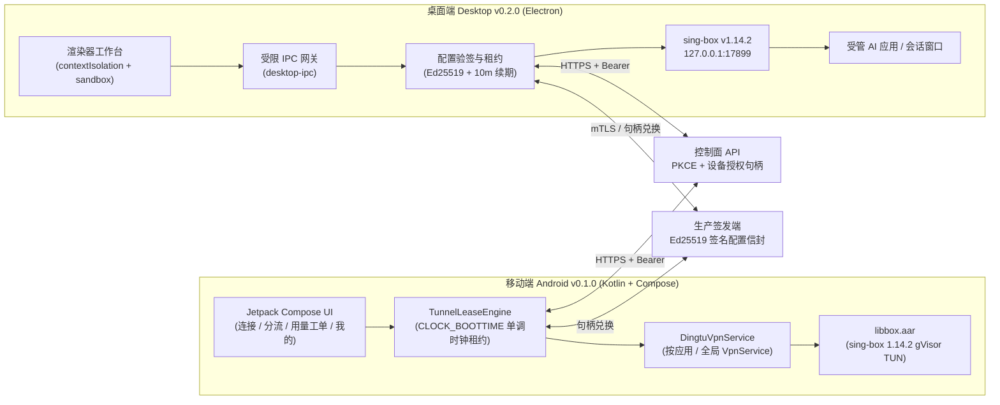
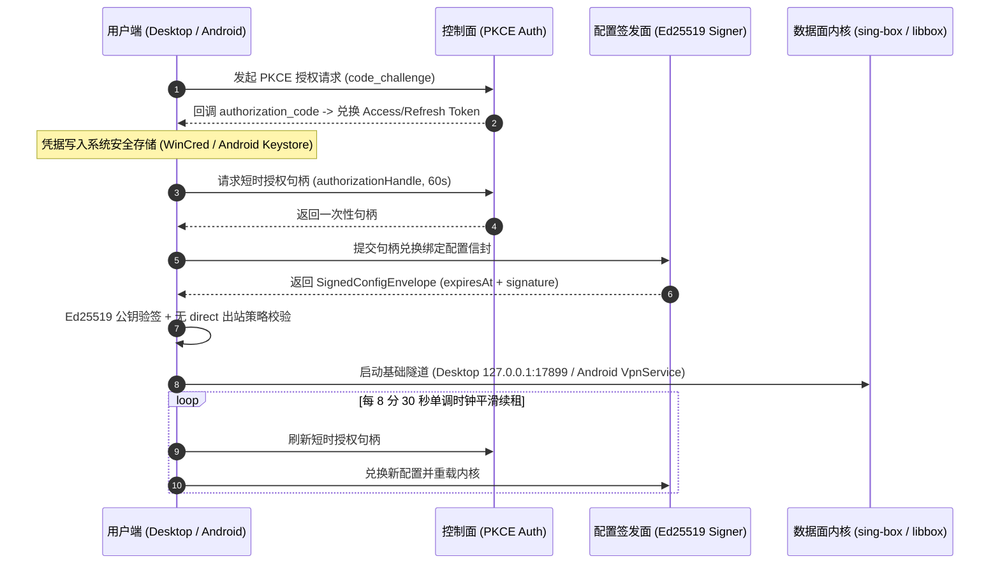

<div align="center">


# 定途 Dingtu — 双端客户端（开源学习交流版）


<p>
  
  
  
  
  
</p>

<p>
  <strong>Electron 桌面工作台 <code>v0.2.0</code> + 原生 Kotlin / Jetpack Compose Android 客户端 <code>v0.1.0</code></strong><br/>
  OAuth2 PKCE 设备绑定 · Ed25519 配置验签 · 本地基础联通链路 · AI 工作台架构参考
</p>

<p>
  <a href="./desktop/README.md">桌面端详细文档</a> ·
  <a href="./android/README.md">Android 端详细文档</a> ·
  <a href="https://dingtu.noyapi.cn/download"><strong>下载官方完整版</strong></a>
</p>

</div>

---

> [!IMPORTANT]
> **版本声明（请先阅读）：**
>
> 1. 本仓库发布的 **桌面端 `v0.2.0`** 与 **Android 端 `v0.1.0`** 为 **开源学习交流版**，仅保留 **基础代理 / 基础 VPN 联通能力** 及 PKCE 登录、Ed25519 验签、UI 工作台、用量与工单架构，用于学习、审计与技术交流。
> 2. 为遵守开源边界，本版本 **已主动剥离** 强代理虚拟网卡（Windows `strong_tun` / `dingtu-tun0`）、UAC 提权、双进程零停机热切换中继（`loopback-relay`）、浏览器 CDP 环境指纹与时区/语言/WebRTC/DNS 防风控防泄露增强模块，以及移动端严格路由（`strict_route`）/ QUIC 阻断 / 时区比对与深度泄露检测组件。
> 3. **如需体验完整官方功能与加强隔离环境，请前往官网下载正式发行版：[https://dingtu.noyapi.cn/download](https://dingtu.noyapi.cn/download)**。

---

## 视觉展示（双端界面与工作台资产）

<table>
  <tr>
    <td align="center" width="34%">
      <br/>
      <sub><b>桌面端 `0.2.0` · 基础代理连接与状态视图</b></sub>
    </td>
    <td align="center" width="33%">
      <br/>
      <sub><b>桌面端 `0.2.0` · AI 应用工作台与多实例视图</b></sub>
    </td>
    <td align="center" width="33%">
      <br/>
      <sub><b>Android `0.1.0` · 原生 Compose 随身连接视图</b></sub>
    </td>
  </tr>
</table>

### 原生适配生态标识

<table>
  <tr>
    <td align="center" width="12%"><br/><sub>Claude</sub></td>
    <td align="center" width="12%"><br/><sub>OpenAI / Codex</sub></td>
    <td align="center" width="12%"><br/><sub>Gemini</sub></td>
    <td align="center" width="12%"><br/><sub>Grok</sub></td>
    <td align="center" width="12%"><br/><sub>Cursor</sub></td>
    <td align="center" width="12%"><br/><sub>Copilot</sub></td>
    <td align="center" width="12%"><br/><sub>Manus</sub></td>
    <td align="center" width="14%"><br/><sub>Meta AI</sub></td>
  </tr>
</table>

---

## 版本差异对比：开源学习交流版 vs 官网完整版

| 功能模块 | 开源学习交流版（GitHub 本仓库） | 完整官方版（[dingtu.noyapi.cn/download](https://dingtu.noyapi.cn/download)） |
| --- | --- | --- |
| **账号认证与设备绑定** | OAuth2 PKCE + 系统安全存储（Credential Manager / Keystore） | 完整保留 |
| **配置防篡改验签** | Ed25519 公钥锚定验签 + 闭合无直连图策略校验 | 完整保留 |
| **桌面端数据面入口** | **两态模式**：基础代理 `127.0.0.1:17899`（`safe_tunnel`）/ `own_network` | **三态模式**：增加 `strong_tun` 内核级按进程接管 |
| **系统提权与网卡清理** | **已剥离**（免管理员权限直接运行基础代理） | Windows UAC 提权 + Wintun `dingtu-tun0` 生命周期守护 |
| **热切换平滑中继** | 常规配置重载 | 双进程零停机平滑 TCP 中继（`loopback-relay`） |
| **环境指纹与防风控** | **已剥离**（不注入 CDP/时区/语言/WebRTC/DNS 伪装） | 完整防泄露容器（CDP 0ms 注入 + UA/Client Hints + DNS/WebRTC 锁） |
| **Android 端隧道核心** | Kotlin + Compose + `libbox.aar` (`sing-box 1.14.2`) 基础 VPN 联通 | 完整 `strict_route` + QUIC 阻断 + 时区/DoH 深度自检 |
| **多实例、用量与工单** | 基础工作台、隔离会话目录、AI 用量分析与工单闭环 UI | 完整企业配额与全链路诊断闭环 |

---

## 系统架构与核心协议流

### 1. 双端基础联通架构



### 2. PKCE 登录与 Ed25519 受控启动时序



---

## 目录结构

```text
dingtu-client/
├── README.md                                  # 本仓库总览（图文说明、架构图、版本对比）
├── LICENSE                                    # MIT 开源协议
├── .gitignore                                 # 忽略构建缓存与本机签名密钥
├── desktop/                                   # 桌面端 Electron 工作台 (v0.2.0)
│   ├── README.md                              # 桌面端图文说明与开发测试指南
│   ├── app.js / index.html / styles.css       # 定途 2.0 渲染器工作台
│   ├── assets/                                # 品牌 Logo、推广 banner 与 AI 应用图标
│   ├── electron/                              # 主进程、安全 IPC、PKCE、验签与基础代理管理
│   │   ├── main.mjs / preload.cjs / desktop-ipc.mjs
│   │   ├── production-proxy.mjs / local-proxy.mjs / environment-mode.mjs
│   │   ├── production-trust.json              # Ed25519 生产公钥信任锚（仅含公钥）
│   │   └── *.test.mjs                         # Electron 主进程与策略单元测试
│   ├── native/                                # OS 原生凭据存储适配 (WinCred / Keychain / SecretService)
│   └── runtime/sing-box/win32-x64/sing-box.exe# 随仓附带 sing-box v1.14.2 Windows 运行时
└── android/                                   # Android 原生客户端 (v0.1.0)
    ├── README.md                              # Android 端图文说明与构建指南
    ├── build.gradle.kts / settings.gradle.kts # Gradle 构建配置 (Kotlin + Compose)
    ├── scripts/build-libbox.ps1               # libbox.aar 可复现交叉编译脚本（环境变量驱动）
    └── app/
        ├── libs/libbox.aar                    # 随仓附带 libbox (sing-box v1.14.2, arm64 + x86_64)
        └── src/
            ├── main/java/cn/noyapi/dingtu/    # auth / config / crypto / ui / vpn 核心源码
            ├── main/res/                      # 移动端 UI 背景、应用图标与启动图标
            └── test/java/cn/noyapi/dingtu/    # JUnit 本地单元测试套件
```

---

## 随仓附带二进制清单

本开源版经确认直接随仓提供运行时内核二进制（均控制在 GitHub 单文件 100 MiB 限制以内，便于克隆后直接进行学习调试与单元测试）：

| 文件路径 | 适用平台 / 架构 | 用途说明 | 文件大小 |
| --- | --- | --- | --- |
| `desktop/runtime/sing-box/win32-x64/sing-box.exe` | Windows x64 | `sing-box v1.14.2` 本地基础代理核心 (`127.0.0.1:17899`) | 81,947,136 bytes (~78.15 MiB) |
| `android/app/libs/libbox.aar` | Android `arm64-v8a`, `x86_64` (API 26+) | 基于 `sing-box v1.14.2` 构建的 `gomobile` VPN 核心库 | 42,401,428 bytes (~40.44 MiB) |

> 如需自行从源码重新编译 Android `libbox.aar`，请参阅 [`android/scripts/build-libbox.ps1`](./android/scripts/build-libbox.ps1) 与 [`android/README.md`](./android/README.md)。

---

## 快速开始与本地单元测试

### 桌面端 (`desktop/`, Node.js 22+)

```bash
cd desktop
# 1. 同步渲染器资源并执行离线公钥信任锚预检
node electron/sync-renderer.cjs
node electron/production-trust.mjs

# 2. 运行全部单元测试（共 323 项用例）
node --test --test-concurrency=2 *.test.mjs
node --test --test-concurrency=2 electron/*.test.mjs
node --test --test-concurrency=1 native/*.test.mjs
```

如需运行 Electron 桌面窗体进行本地开发预览（需自行 `npm install` 安装 `electron` 运行时依赖）：

```bash
cd desktop/electron
npm install
npm start
```

### Android 端 (`android/`, JDK 17 + Android SDK)

```powershell
cd android
$env:JAVA_HOME = "<你的 JDK 17+ 路径>"
$env:ANDROID_HOME = "$env:LOCALAPPDATA\Android\Sdk"

# 运行 37 项 JVM 本地单元测试
.\gradlew.bat testDebugUnitTest --no-daemon

# 如需打包 Debug APK
.\gradlew.bat assembleDebug --no-daemon
```

> 更多细节见 [桌面端 README](./desktop/README.md) 与 [Android 端 README](./android/README.md)。

---

## 安全与开源合规边界

1. **零敏感凭据入库**：本仓库仅包含开源客户端代码、UI 资源与经过剥离的基础运行时内核；所有内部运维脚本、真实服务端 IP、私钥、测试账号、会话 Cookie 与签名私钥（`d` 参数）均不在此仓库中存在。
2. **仅含公开验签公钥**：`production-trust.json` 仅包含 Ed25519 公钥与 `keyId` 摘要，用于离线验证服务器配置信封未被篡改。
3. **仅作学习交流用途**：本仓库不提供任何未授权网络服务接入能力；连接受控网络需配合完整版账户或自行搭建契约兼容的控制面/配置签发服务。

---

## 开源协议与官方完整版

- **开源协议**：[MIT License](./LICENSE)
- **官方完整版下载（含强代理 TUN、提权管理、完整指纹容器与全链路诊断）**：[https://dingtu.noyapi.cn/download](https://dingtu.noyapi.cn/download)
