<div align="center">


# 定途 Dingtu — 双端客户端（开源学习交流版）


<p>
  
  
  
  
  
</p>

<p>
  <strong>面向 AI 开发者与效率团队的受控网络 + 17 款 AI Agent 多账号 / 多开统一工作台</strong><br/>
  多账号无缝切换 · 多实例隔离并发多开 · OAuth2 PKCE + Ed25519 验签 · 基础联通学习版
</p>

<p>
  <a href="#核心功能全景介绍">核心功能介绍</a> ·
  <a href="#17-款-ai-agent-与应用全覆盖矩阵">17 款 AI 支持</a> ·
  <a href="#关于提权与环境指纹--防风控控件与模块的开源剥离说明">剥离边界说明</a> ·
  <a href="./desktop/README.md">桌面端文档</a> ·
  <a href="./android/README.md">Android 端文档</a> ·
  <a href="https://github.com/guowei-3399/dingtu-client/releases">开源版安装包 (Releases)</a> ·
  <a href="https://dingtu.noyapi.cn/download"><strong>官网下载完整版</strong></a>
</p>

</div>

---

> [!IMPORTANT]
> **开源学习交流版声明（请先阅读）：**
>
> 1. 本仓库发布的 **桌面端 `v0.2.0`** 与 **Android 端 `v0.1.0`** 为 **开源学习交流版**。在完整保留 **定途 2.0 多账号无缝切换、应用多开、17 款 AI Agent 注册表与多实例工作台、PKCE 授权登录、Ed25519 验签及基础联通链路（桌面 `127.0.0.1:17899` / Android 基础 `VpnService`）** 的前提下：
> 2. 为遵守开源边界，本版本 **已严格剥离所有「强代理 TUN、系统提权与环境指纹 / 防风控控件与模块」**——包括 Windows `strong_tun`（`dingtu-tun0`）虚拟网卡与 UAC 管理员提权模块（`tun-privilege`）、双进程零停机平滑热中继（`loopback-relay`）、CDP 0ms 硬件指纹与 Client Hints/字体注入引擎（`anti-detect-fingerprint`）、时区/语言/WebRTC/DNS 防泄露强制锁、`browser.fingerprintCheck`「环境指纹自检」弹窗与 UI 控件，以及 Android 端 `strict_route`、QUIC 拒绝规则与时区/DoH 深度泄露审计模块。
> 3. **如需开箱使用上述提权强代理、全维环境指纹加强与防风控全功能，请前往官网下载正式完整发行版：[https://dingtu.noyapi.cn/download](https://dingtu.noyapi.cn/download)**。

---

## 视觉展示（双端实机界面预览）

<table>
  <tr>
    <td align="center" width="40%">
      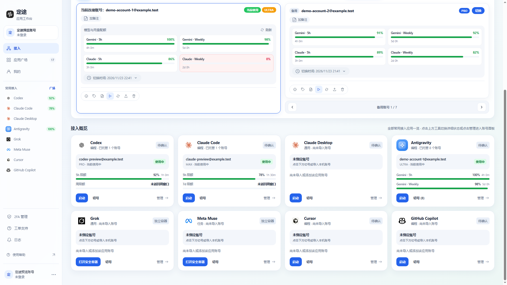<br/>
      <sub><b>桌面端 v0.2.0 · 基础代理连接与接入总览</b></sub>
    </td>
    <td align="center" width="40%">
      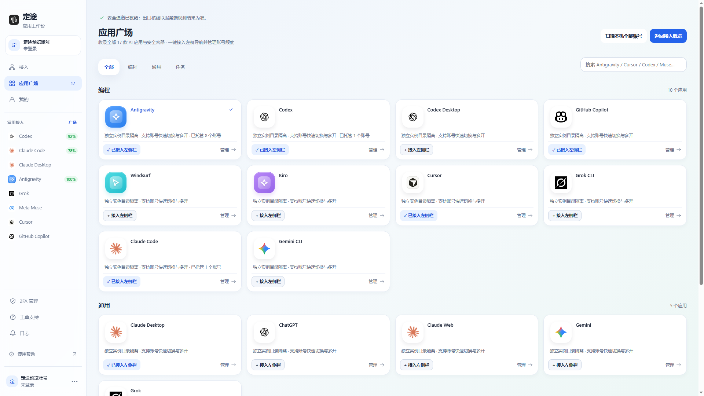<br/>
      <sub><b>桌面端 v0.2.0 · 17 款 AI 工作台、多账号与多开面板</b></sub>
    </td>
    <td align="center" width="20%">
      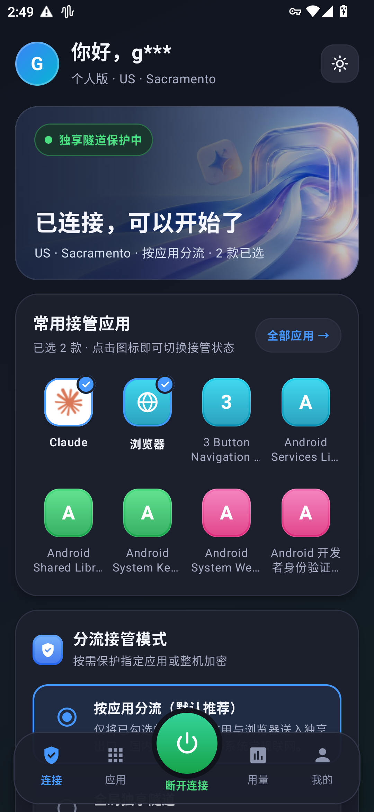<br/>
      <sub><b>Android v0.1.0 · 竖屏原生 Compose 连接与分流</b></sub>
    </td>
  </tr>
</table>

<p align="center">
  &nbsp;&nbsp;&nbsp;
  &nbsp;&nbsp;&nbsp;
  &nbsp;&nbsp;&nbsp;
  &nbsp;&nbsp;&nbsp;
  &nbsp;&nbsp;&nbsp;
  &nbsp;&nbsp;&nbsp;
  &nbsp;&nbsp;&nbsp;
  
</p>

---

## 核心功能全景介绍

定途围绕 **「稳定联通 + 高效多账号协作 + 防串号环境隔离」** 设计，以下是系统完整能力全景（其中环境指纹加强与提权 TUN 部分在 GitHub 开源版中按规范剥离，完整体验位于官网发行版）：

### 1. 多账号无缝切换与智能调度

- **原子切号与反污染自愈**：在 Electron 主进程工作台（`workbench-accounts.mjs` / `local-account-importers.mjs`）内实现原子写入、切换前自动备份旧凭据，以及 Codex / Antigravity `authMeta` / 账号身份核验，杜绝跨账号上下文污染并在异常时自动自愈读回确认。
- **全形态凭据接管与 OS 安全落盘**：支持「一键导入本机已登录账号」「OAuth 授权接入」「Token / Refresh Token 导入」「JSON 批量导入导出」，敏感凭据全部写入系统原生安全存储（Windows Credential Manager / macOS Keychain / Linux Secret Service / Android Keystore），不以明文暴露给渲染层。
- **双维度配额看板与自动化策略**：
  - 实时查询并对齐展示 **5 小时窗口额度（5h Quota）** 与 **周额度（Weekly Quota）**，不虚构百分比；
  - 支持账号自定义备注、分组管理、**定时自动唤醒（`wakeup-scheduler`）** 与 **RFC 6238 2FA TOTP 本地加密令牌管理 / 迁移二维码扫描**；
  - 支持企业团队跨端 AI Token 用量聚合分析（按会话/轮次/思考 Token 脱敏上云）与服务工单闭环。

<table>
  <tr>
    <td align="center" width="50%">
      <br/>
      <sub><b>桌面工作台接入总览：多账号 5h / Weekly 实时配额对比与一键切号启动</b></sub>
    </td>
    <td align="center" width="50%">
      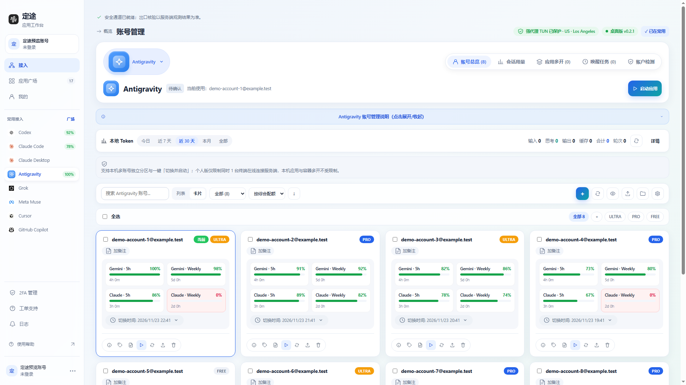<br/>
      <sub><b>多账号池与配额视图：支持别名/分组、ULTRA/PRO 分级、账户检测与应用多开切换</b></sub>
    </td>
  </tr>
</table>

### 2. 应用多开与独立存储目录隔离

- **CLI Agent 多开目录隔离**：通过 `safe-environment.mjs` 与 `agent-instance-host.mjs` 为不同 CLI 实例绑定专属环境变量配置根目录（例如 `CODEX_HOME`、`CLAUDE_CONFIG_DIR`、`GROK_HOME`、`GEMINI_CLI_HOME`、`XDG_CONFIG_HOME`），多个 Agent 会话并行执行代码任务互不覆盖 auth 状态。
- **桌面 IDE 主副实例协同**：主实例（`main`）保留本机原生用户配置目录，企业或个人扩展副实例自动挂载按设备作用域隔离的独立 `--user-data-dir`，允许同一台机器同时运行多个互不干扰的 IDE 窗口。
- **网页应用多容器并发**：通过 `isolated-browser.mjs` 为不同实例生成基于 SHA-256 作用域哈希的 `persist:dingtu-browser-<hash>` 持久化 Chromium 会话分区，同一款网页 AI 工具（如 Claude Web、ChatGPT、Manus、Meta Muse）可同时打开多个独立登录实例，Cookie、IndexedDB 与 localStorage 物理完全隔离。

<p align="center">
  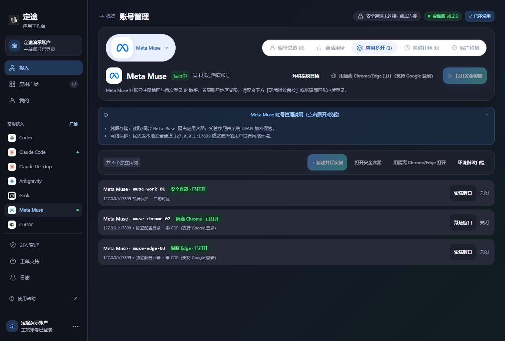<br/>
  <sub><b>深色应用多开视图：安全容器 / 隔离 Chrome / 隔离 Edge 多实例并行隔离运行，顶部集成「账号总览 / 会话用量 / 应用多开 / 唤醒任务 / 账户检测」管理页签</b></sub>
</p>

### 3. 17 款 AI Agent 与应用全覆盖矩阵

定途 2.0 桌面工作台（`assistant-catalog.js`）原生收录全部 **17 款** 主流 AI 编程助手、命令行 Agent、自动化任务平台与大模型网页工作台，统一在一个入口完成检测、鉴权导入、切号、多开、用量统计与进程生命周期控制：

| 分类 | 应用标识（`appId`） | 应用名称 | 形态与接入能力 |
| --- | --- | --- | --- |
| **编程 IDE / Agent（10 款）** | `antigravity` | **Antigravity** | 桌面应用启动 + 本地凭据导入/无缝切换 + 额度查询 + 多开 |
| | `codex` | **Codex CLI** | CLI 多开（`CODEX_HOME`）+ OAuth/Token 接管 + 配额监控 + 本地 JSONL 用量统计 |
| | `codex-desktop` | **Codex Desktop** | MSIX / 桌面客户端协同启动与统一进程关闭控制 |
| | `copilot` | **GitHub Copilot** | GitHub Device Flow 授权 + 配额实时同步 |
| | `windsurf` | **Windsurf** | 桌面 IDE 独立 `--user-data-dir` 多开与代理协同 |
| | `kiro` | **Kiro** | 桌面应用 + Token 导入/刷新与多实例运行 |
| | `cursor` | **Cursor** | 桌面 IDE 多开隔离 + 本机 SQLite/凭据切号与配额检查 |
| | `grok-cli` | **Grok CLI** | CLI 独立 `GROK_HOME` 目录多开与代理环境变量注入 |
| | `claude-code` | **Claude Code** | CLI 独立 `CLAUDE_CONFIG_DIR` 多开 + 额度同步 + 本地会话用量统计 |
| | `gemini-cli` | **Gemini CLI** | CLI 独立 `GEMINI_CLI_HOME` 多开 + OAuth / 额度监控 |
| **任务与桌面容器（3 款）** | `claude-desktop` | **Claude Desktop** | 桌面客户端本机启动管理与安全代理链路衔接 |
| | `metamuse` | **Meta Muse** | `muse.ai` 独立应用壳层多实例 + 自动会话捕获 |
| | `manus` | **Manus** | `manus.im` 独立应用壳层多实例 + 持久化会话隔离 |
| **对话网页容器（4 款）** | `chatgpt` | **ChatGPT** | `chatgpt.com` 多账号容器并行 + 分区持久化登录态 |
| | `claude` | **Claude Web** | `claude.ai` 多账号容器并行 + 分区持久化登录态 |
| | `gemini-web` | **Gemini** | `gemini.google.com` 多账号容器并行 |
| | `grok` | **Grok** | `grok.com` 多账号容器并行 |

> Android 移动端（`v0.1.0`）提供随身伴侣模式：通过系统级 `VpnService` 按应用精准勾选上述受管移动端 AI 应用与浏览器（或全局路由），并在同一套账户体系下查看 AI 用量与工单。

<p align="center">
  <br/>
  <sub><b>应用广场实拍截图：全收录 17 款编程 IDE / CLI Agent、任务应用与网页对话容器，支持一键扫描导入与接入左侧常驻导航</b></sub>
</p>

### 4. 环境指纹加强与防风控体系（官网完整版能力说明）

在官网完整发行版（[https://dingtu.noyapi.cn/download](https://dingtu.noyapi.cn/download)）中，针对多账号协同与海外 AI 服务严格风控，桌面端与移动端提供四层递进的环境加强与泄露防护：

1. **UAC 受控提权与内核级按进程强代理（`strong_tun`）**：
   - Windows 通过受控 UAC 提权（`tun-privilege`）拉起名为 `dingtu-tun0` 的 Wintun 虚拟网卡，仅接管工作台白名单内 AI 应用及容器进程的 TCP/UDP 流量（配合 `loopback-relay` 双进程零停机热续租），避免全局接管本机其他软件或与外部 `7890` 工具冲突。
2. **CDP 0ms 浏览器硬软件指纹一致化隔离**：
   - 在隔离容器加载任何目标网站前（`about:blank` 预热阶段通过 CDP 零毫秒注入），统一生成绑定实例槽种子的 Canvas / WebGL / Audio / Screen / HardwareConcurrency 指纹参数，同步清洗 Electron UA 与 `Sec-CH-UA` Client Hints，并屏蔽暴露本地系统特征的 CJK 字体。
3. **出口地理环境对齐与全栈泄露封堵**：
   - 自动根据服务端下发的 `exitContext` 通过 CDP + 进程环境变量注入匹配的 IANA 时区（`TZ` / `Emulation.setTimezoneOverride`）、`Accept-Language`、`--lang` 与虚拟地理坐标（`Emulation.setGeolocationOverride`）；
   - 锁定 `--host-resolver-rules` 与 FakeIP / 远端 DoH DNS 解析防止本地 DNS 泄露，开启 WebRTC `disable_non_proxied_udp` 阻断真实内/外网 IP 泄露，拦截网页对 `localhost` / `127.0.0.1:7890/17899` / RFC1918 内网的端口扫描探针。
4. **双端环境风控与链路核验**：
   - **桌面端**内置「一键环境指纹自检」，实测核验出口 IP、观测时区、语言、Clean Chrome UA、Client Hints、CJK 字体掩码、`dingtu-tun0` 状态并出具全绿诊断报告；
   - **Android 端**完整版启用 `strict_route: true` 防泄露路由锁、QUIC UDP 阻断规则，并在连接页提供目标出口时区一致性风险比对与远端 DoH 链路深度检测。

<p align="center">
  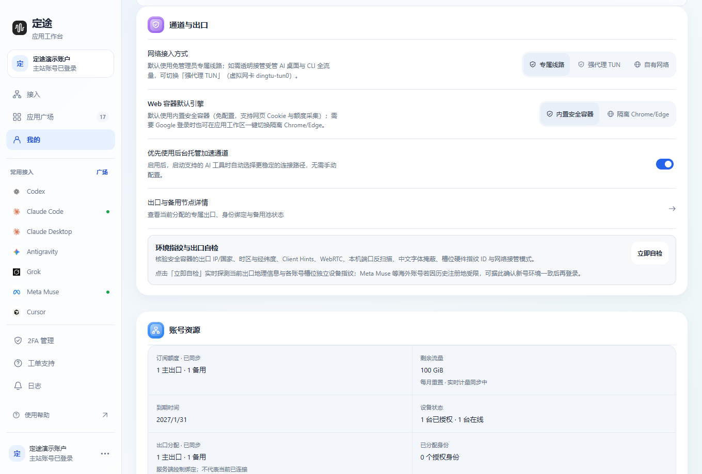<br/>
  <sub><b>官网完整版专属控制面实拍（开源版已按规范剥离）：包含「专属线路 / 强代理 TUN（虚拟网卡 dingtu-tun0）/ 自有网络」三态切换、安全容器/隔离 Chrome/Edge 引擎选择及「环境指纹与出口自检」控件</b></sub>
</p>

### 5. Android 移动端竖屏实拍截图展示（`v0.1.0` 原生手机界面）

<table>
  <tr>
    <td align="center" width="25%">
      <br/>
      <sub><b>暗色连接主页：独享隧道、常用接管应用与按应用分流</b></sub>
    </td>
    <td align="center" width="25%">
      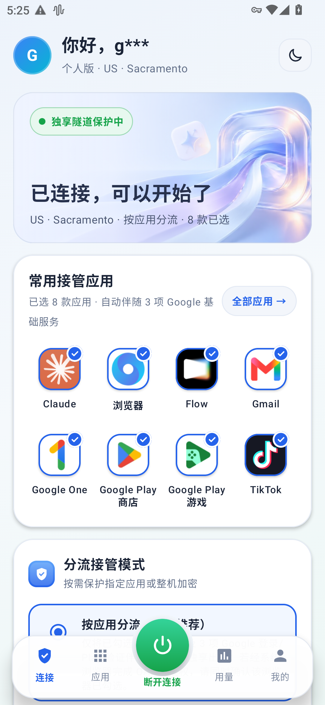<br/>
      <sub><b>浅色连接主页：日间外观一键切换与快捷 AI 接管</b></sub>
    </td>
    <td align="center" width="25%">
      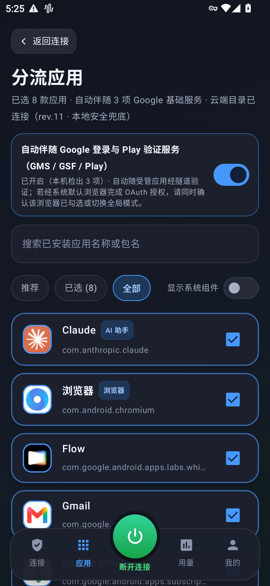<br/>
      <sub><b>按应用分流页：精准勾选 AI 与浏览器，支持自动伴随 Google 服务</b></sub>
    </td>
    <td align="center" width="25%">
      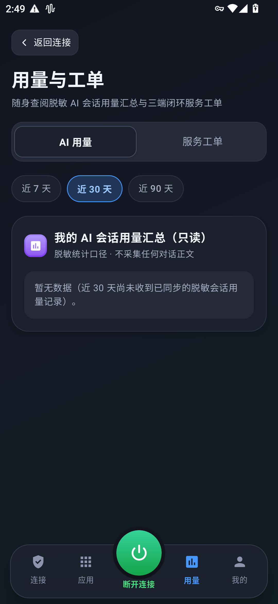<br/>
      <sub><b>用量与工单页：7/30/90 天脱敏会话汇总与工单闭环</b></sub>
    </td>
  </tr>
</table>

---

## 关于「提权与环境指纹 / 防风控控件与模块」的开源剥离说明

为遵守开源安全边界并明确 **GitHub 开源学习交流版** 与 **官网完整版** 的界线，以下模块与 UI 控件已在开源版中 **按规范精确剥离**（完整保留了多账号切换、应用多开、17 款 AI 接入与基础 `127.0.0.1:17899` / `VpnService` 联通）：

| 端别 | 已剥离的提权与环境指纹 / 防风控控件与模块 | 开源版保留替代实现 | 完整版获取方式 |
| --- | --- | --- | --- |
| **桌面端 (`desktop/`)** | • `electron/tun-privilege.mjs`（Windows UAC 管理员提权探测与提权重启）<br>• `electron/loopback-relay.mjs`（双进程 TUN 零停机 TCP 中继）<br>• `electron/anti-detect-fingerprint.mjs`（CDP 0ms 硬件指纹 / Client Hints / CJK 字体掩码）<br>• `strong_tun`、`dingtu-tun0` 模式开关与 UAC 提权提示弹窗<br>• `--host-resolver-rules`、WebRTC `disable_non_proxied_udp`、`TZ`/`--lang` 覆写<br>• `browser.fingerprintCheck` IPC 与界面「环境指纹自检」控件 | 收敛为两态网络模式：**基础代理（`safe_tunnel`，固定 `127.0.0.1:17899` HTTP/SOCKS5）** 与 **自有网络（`own_network`）**；保留多实例 `persist:` / `--user-data-dir` / CLI 目录隔离、Clean Chrome UA 与本机端口扫描防护 | 前往官网下载完整版：<br>[dingtu.noyapi.cn/download](https://dingtu.noyapi.cn/download) |
| **Android 端 (`android/`)** | • `AndroidLibboxConfigBuilder` 中的 `strict_route: true` 严格防泄露路由锁<br>• `route.rules` 中的 `quic` 协议强制 `reject` 规则<br>• `ExitSelfCheckService` 中的系统时区/语言一致性风控风险比对（`TimezoneAlignmentState`）与深度 DoH 延时防泄露审计卡片 | 保留 `gvisor` TUN 基础入站、`vless` `noya-device` 单出口（零 `direct`）、`sniff` + `hijack-dns` 基础规则、`BasicConnectivityCheckService` 基础外网可达性检测，以及主页显式「开源学习交流版」提示卡片 | 前往官网下载完整版：<br>[dingtu.noyapi.cn/download](https://dingtu.noyapi.cn/download) |

---

## 版本差异对比：开源学习交流版 vs 官网完整版

| 能力维度 | 开源学习交流版（GitHub 本仓库） | 完整官方版（[dingtu.noyapi.cn/download](https://dingtu.noyapi.cn/download)） |
| --- | --- | --- |
| **OAuth2 PKCE + Ed25519 验签** | 完整保留（含系统安全存储与 10m 租约续期） | 完整保留 |
| **17 款 AI Agent 注册表 & 多账号无缝切换** | 完整保留（支持本机/Token/JSON、5h+Weekly 额度、2FA TOTP） | 完整保留 |
| **应用多开（CLI / IDE / 独立网页分区）** | 完整保留（基础代理或自有网络路由） | 完整保留 + 叠加内核与指纹层保护 |
| **桌面端基础数据面联通** | 两态：`safe_tunnel` (`127.0.0.1:17899`) / `own_network` | 三态：新增 **`strong_tun`** 内核按进程强接管 |
| **Windows UAC 提权与 `dingtu-tun0` 守护** | **已剥离**（免管理员权限直接学习与运行） | **完整内置**（含 `loopback-relay` 零停机热续租） |
| **CDP 环境指纹加强与时区/DNS/WebRTC 防护** | **已剥离**（仅保留基础代理连接） | **完整内置**（含一键「环境指纹自检」全绿校验） |
| **Android `VpnService` + `libbox.aar`** | 基础按应用 / 全局 TUN 联通 + 基础探测 | 完整 `strict_route` + QUIC 阻断 + 时区/DoH 自检 |

---

## 系统架构与核心协议流

### 1. 双端基础联通架构

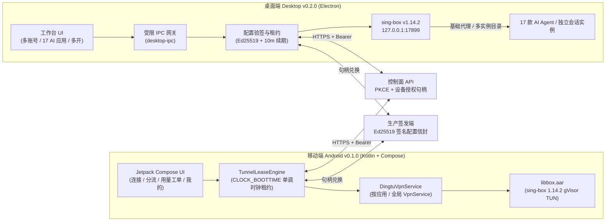

### 2. PKCE 登录与 Ed25519 受控启动时序

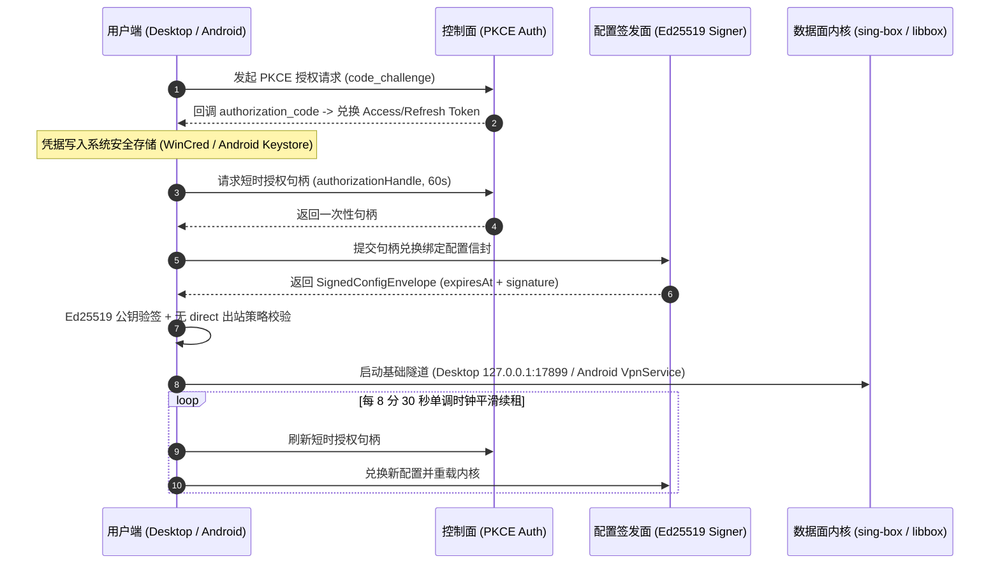

---

## 目录结构

```text
dingtu-client/
├── README.md                                  # 仓库总览：能力全景、17 AI 矩阵、剥离说明、Mermaid 架构图
├── LICENSE                                    # MIT License
├── .gitignore                                 # 屏蔽本地缓存、node_modules、Gradle 构建产物与签名密钥
├── desktop/                                   # 桌面端开源学习交流版 (v0.2.0)
│   ├── README.md                              # 桌面端工作台、多账号/多开及剥离细节说明
│   ├── app.js / index.html / styles.css       # 定途 2.0 渲染器工作台
│   ├── assistant-catalog.js                   # 17 款 AI Agent 与容器注册表契约
│   ├── assets/                                # 品牌 Logo、推广 banner 与 AI 应用图标
│   ├── electron/                              # 主进程、受限 IPC、验签、基础代理与多账号工作台引擎
│   │   ├── main.mjs / preload.cjs / desktop-ipc.mjs
│   │   ├── workbench-accounts.mjs / local-account-importers.mjs / wakeup-scheduler.mjs
│   │   ├── agent-instance-host.mjs / app-launcher.mjs / isolated-browser.mjs
│   │   ├── production-proxy.mjs / local-proxy.mjs / environment-mode.mjs
│   │   ├── production-trust.json              # Ed25519 生产公钥信任锚（仅含公钥）
│   │   └── *.test.mjs                         # Electron 主进程与策略单元测试
│   ├── native/                                # OS 原生凭据存储适配 (WinCred / Keychain / SecretService)
│   └── runtime/sing-box/win32-x64/sing-box.exe# 随仓附带 sing-box v1.14.2 Windows 运行时
└── android/                                   # Android 原生开源学习交流版 (v0.1.0)
    ├── README.md                              # Android 端构建、按应用分流与剥离细节说明
    ├── build.gradle.kts / settings.gradle.kts # Gradle 构建配置 (Kotlin + Compose)
    ├── scripts/build-libbox.ps1               # libbox.aar 可复现交叉编译脚本（环境变量驱动）
    └── app/
        ├── libs/libbox.aar                    # 随仓附带 libbox (sing-box v1.14.2, arm64 + x86_64)
        └── src/
            ├── main/java/cn/noyapi/dingtu/    # auth / config / crypto / ui / vpn 核心源码
            ├── main/res/                      # 移动端 UI 背景、应用图标与启动图标
            └── test/java/cn/noyapi/dingtu/    # JUnit 本地单元测试套件
```

---

## 随仓附带二进制清单

本仓库遵循《[开源版发布规范](https://github.com/guowei-3399/dingtu-client)》随仓保留经 SHA-256 校验的基础运行时内核（单文件均 `< 100 MiB`），克隆即可直接联调与运行单测：

| 文件路径 | 适用平台 / 架构 | 用途说明 | 文件大小 |
| --- | --- | --- | --- |
| `desktop/runtime/sing-box/win32-x64/sing-box.exe` | Windows x64 | `sing-box v1.14.2` 本地基础代理核心 (`127.0.0.1:17899`) | 81,947,136 bytes (~78.15 MiB) |
| `android/app/libs/libbox.aar` | Android `arm64-v8a`, `x86_64` (API 26+) | 基于 `sing-box v1.14.2` 构建的 `gomobile` VPN 核心库 | 42,401,428 bytes (~40.44 MiB) |

> 如需自行从源码重新编译 Android `libbox.aar`，请参阅 [`android/scripts/build-libbox.ps1`](./android/scripts/build-libbox.ps1) 与 [`android/README.md`](./android/README.md)。

---

## 快速开始与本地单元测试

### 获取开源学习交流版安装包（GitHub Releases）

如不自行源码编译，可直接在 [GitHub Releases](https://github.com/guowei-3399/dingtu-client/releases) 下载**基于本开源剥离分支重新构建**的试运行安装包（附带 `.sha256` 校验文件）：

- **桌面端开源版 (`desktop-v0.2.0`)**：Windows x64 便携可执行文件（已剥离提权/强代理 TUN/指纹模块）
- **Android 端开源版 (`android-v0.1.0`)**：Android 安装包 `.apk`（已剥离 `strict_route`/QUIC 拒绝/时区与 DoH 自检）

> 若需要包含 **UAC 提权 `dingtu-tun0` 强代理与环境指纹防风控加强** 的正式生产客户端，请前往官网下载：**[https://dingtu.noyapi.cn/download](https://dingtu.noyapi.cn/download)**

### 桌面端 (`desktop/`, Node.js 22+)

```bash
cd desktop
# 1. 同步渲染器资源并执行离线公钥信任锚预检
node electron/sync-renderer.cjs
node electron/production-trust.mjs

# 2. 运行全部单元测试（共 323 项用例）
node --test --test-concurrency=2 *.test.mjs
node --test --test-concurrency=2 electron/*.test.mjs
node --test --test-concurrency=1 native/*.test.mjs
```

> **第三方 OAuth 凭据说明**：开源版已将 `desktop/electron/oauth-account-flow.mjs` 中的第三方 Google OAuth Client ID/Secret 替换为环境变量读取，如需本地触发相关 OAuth 流程，可按需设置 `DINGTU_ANTIGRAVITY_OAUTH_CLIENT_ID` / `DINGTU_ANTIGRAVITY_OAUTH_CLIENT_SECRET` 与 `DINGTU_GEMINI_CLI_OAUTH_CLIENT_ID` / `DINGTU_GEMINI_CLI_OAUTH_CLIENT_SECRET`。

如需启动 Electron 桌面端预览（需先在 `desktop/electron` 安装本地依赖）：

```bash
cd desktop/electron
npm install
npm start
```

### Android 端 (`android/`, JDK 17+ & Android SDK)

```powershell
cd android
$env:JAVA_HOME = "<你的 JDK 17+ 路径>"
$env:ANDROID_HOME = "$env:LOCALAPPDATA\Android\Sdk"

# 运行 37 项 JVM 本地单元测试
.\gradlew.bat testDebugUnitTest --no-daemon

# 如需打包 Debug APK
.\gradlew.bat assembleDebug --no-daemon
```

---

## 安全与开源合规边界

1. **零敏感凭据与内控信息**：仓库已按脱敏规范清理内部打包记录、真实服务端/出口 IP、测试私钥、OAuth Client Secret 字面量与宿主机绝对路径。
2. **仅含公开验签公钥**：`production-trust.json` 仅包含 Ed25519 公钥（不含私钥字段 `d`），用于本地离线核验服务器签名配置。
3. **仅作技术学习交流**：本开源版仅用于架构审计、协议学习与基础联通演示；生产环境使用或需要提权 TUN 与环境指纹防风控全套能力，请前往官方下载。

---

## 开源协议与官方完整版

- **开源协议**：[MIT License](./LICENSE)
- **官方完整版下载（含 17 款 AI 完整协同 + 提权强代理 TUN + 全维环境指纹加强与防风控）**：[https://dingtu.noyapi.cn/download](https://dingtu.noyapi.cn/download)
