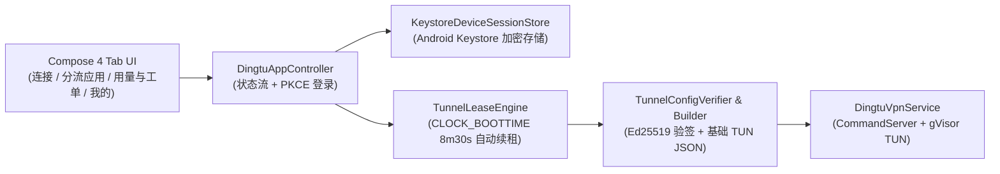

<div align="center">


# 定途 Android 客户端 Dingtu Android `v0.1.0`（开源学习交流版）

<p>
  
  
  
  
</p>

[返回仓库首页](../README.md) · [官方完整版下载](https://dingtu.noyapi.cn/download)

</div>

---

> [!IMPORTANT]
> **开源学习交流版说明**：Android `v0.1.0` 遵循纯正原生架构（Kotlin + Jetpack Compose + `sing-box v1.14.2` `libbox.aar` + Android `VpnService`），已在开源版中 **剥离严格路由防泄露（`strict_route`）、QUIC 阻断规则以及系统时区/语言对齐风险比对与深度 DoH 泄露审计**，仅保留 **基础 TUN 联通、按应用/全局分流与基础可达性检测**。完整版请前往官网下载：**[https://dingtu.noyapi.cn/download](https://dingtu.noyapi.cn/download)**。

---

## 移动端视觉资产

<table>
  <tr>
    <td align="center" width="52%">
      <br/>
      <sub><b>主连接界面 Hero 视效卡片（自适应手机 / 平板断点）</b></sub>
    </td>
    <td align="center" width="48%">
      <p>
        &nbsp;&nbsp;
        <br/><br/>
        &nbsp;&nbsp;
        
      </p>
      <sub><b>内置常用 AI 应用按应用分流快捷矩阵</b></sub>
    </td>
  </tr>
</table>

---

## 架构概览与开源版裁剪细节



### 本版本与官方完整版差异

| 模块文件 | 开源版改动 | 功能说明 |
| --- | --- | --- |
| `config/AndroidLibboxConfigBuilder.kt` | **剥离** `strict_route` 与 `quic` 拒绝规则 | 保留 gVisor `tun-in` + `vless` `noya-device` + `sniff` + `hijack-dns` 2 条基础路由规则，禁止注入 `direct` 出站 |
| `diagnostics/ExitSelfCheckService.kt` | **简化为** `BasicConnectivityCheckService` | 移除 `TimezoneAlignmentState` 时区一致性对齐建议与 DoH 延时防泄露审计，保留基础外网连通探测与出口 IP 脱敏展示 |
| `ui/screens/ConnectTabScreen.kt` | **新增开源提示卡片** | 在连接主页显著展示「开源学习交流版」说明与官网完整版下载入口 |
| `scripts/build-libbox.ps1` | **环境变量参数化** | 改用 `$env:SINGBOX_SRC_DIR`、`ANDROID_HOME`、`JAVA_HOME`、`TEMP`，移除硬编码本机路径 |

---

## 构建与单元测试

### 1. 运行 JVM 单元测试

```powershell
cd android
$env:JAVA_HOME = "<你的 JDK 17+ 路径>"
$env:ANDROID_HOME = "<你的 Android SDK 路径>"

.\gradlew.bat testDebugUnitTest --no-daemon
```

> 预期输出：`BUILD SUCCESSFUL`，12 个测试套共 37 项用例全部通过（0 失败 / 0 跳过）。

### 2. 重新编译双架构 `libbox.aar`（可选）

仓库已包含验证通过的 `app/libs/libbox.aar`（支持 `arm64-v8a` 与 `x86_64`，基于 `sing-box v1.14.2`）。如需自行复现编译：

```powershell
$env:SINGBOX_SRC_DIR = "<本地 sing-box v1.14.2 源码路径>"
$env:ANDROID_HOME = "<本地 Android SDK 路径>"
$env:JAVA_HOME = "<本地 JDK 17+ 路径>"

.\scripts\build-libbox.ps1
```

---

## 获取完整官方版

需要严格路由防泄露、系统时区对齐自检与全部商用稳定性能力的完整客户端，请访问官网下载页：**[https://dingtu.noyapi.cn/download](https://dingtu.noyapi.cn/download)**。
