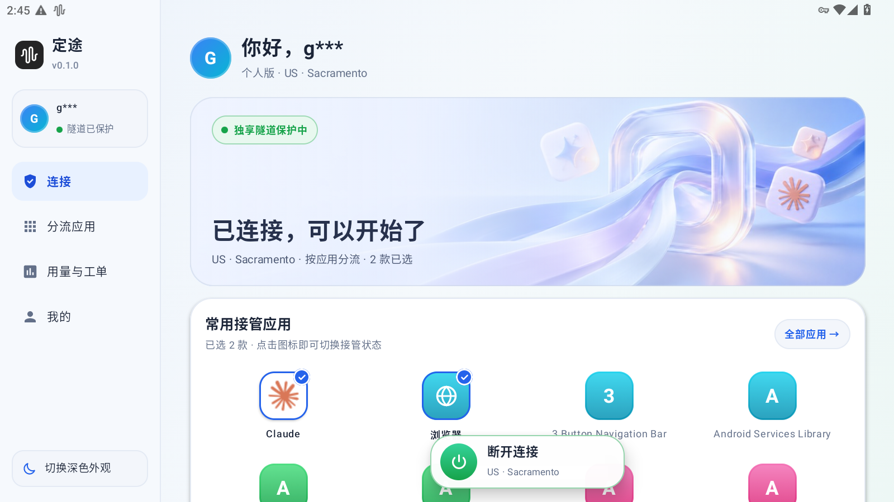
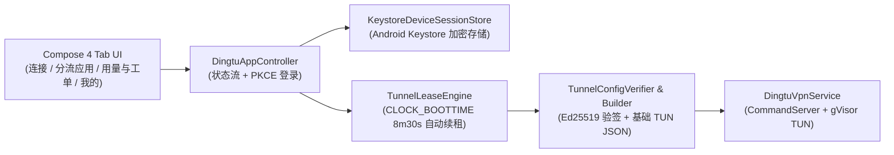

<div align="center">


# 定途 Android 客户端 Dingtu Android `v0.1.0`（开源学习交流版）

<p>
  
  
  
  
</p>

[返回仓库首页](../README.md) · [官方完整版下载](https://dingtu.noyapi.cn/download)

</div>

---

> [!IMPORTANT]
> **开源学习交流版说明**：Android `v0.1.0` 与定途 [桌面端 2.0 AI 工作台](../desktop/README.md) 配套协同（桌面端负责 17 款 AI Agent 多账号无缝切换与多开，移动端专注随身 AI 应用按应用分流 VPN 与跨端用量/工单管理）。本开源版基于 Kotlin + Jetpack Compose + `sing-box v1.14.2` `libbox.aar` + Android `VpnService`，**已精确剥离严格防泄露路由锁（`strict_route`）、QUIC 协议阻断规则以及出口时区/语言一致性风控比对与深度 DoH 泄露审计**，仅保留 **基础 TUN 联通与基础外网探测**。完整版请前往官网下载：**[https://dingtu.noyapi.cn/download](https://dingtu.noyapi.cn/download)**。

---

## 移动端视觉资产

<table>
  <tr>
    <td align="center" width="52%">
      <br/>
      <sub><b>主连接界面 Hero 视效卡片（自适应手机 / 平板断点）</b></sub>
    </td>
    <td align="center" width="48%">
      <p>
        &nbsp;&nbsp;
        <br/><br/>
        &nbsp;&nbsp;
        
      </p>
      <sub><b>内置常用移动端 AI 应用按应用分流快捷矩阵</b></sub>
    </td>
  </tr>
</table>

### 移动端实拍截图（暗色/浅色手机与平板自适应布局）

<table>
  <tr>
    <td align="center" width="24%">
      <br/>
      <sub><b>手机端（暗色）：一键连接与按应用分流</b></sub>
    </td>
    <td align="center" width="26%">
      <br/>
      <sub><b>平板端（浅色）：侧边栏自适应与隧道状态</b></sub>
    </td>
    <td align="center" width="25%">
      <br/>
      <sub><b>分流应用页：精准勾选 AI 与浏览器进入隧道</b></sub>
    </td>
    <td align="center" width="25%">
      <br/>
      <sub><b>用量与工单页：跨端脱敏会话用量与工单闭环</b></sub>
    </td>
  </tr>
</table>

> 可在 [GitHub Releases (`android-v0.1.0`)](https://github.com/guowei-3399/dingtu-client/releases/tag/android-v0.1.0) 下载由当前开源剥离源码构建的试运行 `.apk`；如需完整版强防泄露与环境自检能力请前往 [dingtu.noyapi.cn/download](https://dingtu.noyapi.cn/download)。

---

## 架构概览与「防风控 / 防泄露增强」剥离说明



### 开源版剥离 vs 完整官方版

| 模块 / 能力 | 开源学习交流版处置 | 官网完整版加强能力（[dingtu.noyapi.cn/download](https://dingtu.noyapi.cn/download)） |
| --- | --- | --- |
| **TUN 防泄露与协议规则** (`config/AndroidLibboxConfigBuilder.kt`) | **剥离** `strict_route: true` 与 `{"protocol":["quic"],"action":"reject"}`；保留 `gvisor` `tun-in` + 已验签单 `vless` 出站（零 `direct`）+ `sniff` + `hijack-dns` 基础路由 | 强制开启 `strict_route: true` 防泄露锁并阻断 QUIC 回退通道，确保受管 AI 应用 DNS 与流量零本地泄漏 |
| **环境风控自检与泄露审计** (`diagnostics/ExitSelfCheckService.kt` / `ConnectTabScreen.kt`) | **简化为** `BasicConnectivityCheckService`；移除 `TimezoneAlignmentState` 出口时区对齐比对与 DoH 延时泄露审计，主页常驻展示「开源学习交流版」及官网完整版下载按钮 | 实时比对手机系统时区与分配出口的 IANA 时区一致性风险提示、自动探测远端 DoH 解析延时与受管边界合规报告 |
| **基础按应用 / 全局分流与账户体系** (`vpn/`、`auth/`、`storage/`、`ui/`) | **完整保留**：PKCE 登录、Android Keystore 安全存储、`CLOCK_BOOTTIME` 单调时钟租约续签、按应用/全局 `VpnService` 切换与跨端用量/工单查看 | 与桌面端 17 款 AI 工作台同一账号共享套餐权益、设备管理、用量大盘与服务工单 |
| **编译辅助脚本** (`scripts/build-libbox.ps1`) | **环境变量化**：使用 `$env:SINGBOX_SRC_DIR`、`ANDROID_HOME`、`JAVA_HOME`、`TEMP`，移除硬编码本机路径 | 同套可复现 `gomobile` 构建管线 |

---

## 构建与单元测试

### 1. 运行 JVM 单元测试

```powershell
cd android
$env:JAVA_HOME = "<你的 JDK 17+ 路径>"
$env:ANDROID_HOME = "$env:LOCALAPPDATA\Android\Sdk"

.\gradlew.bat testDebugUnitTest --no-daemon
```

> 预期输出：`BUILD SUCCESSFUL`，12 个测试套共 37 项用例全部通过（0 失败 / 0 跳过）。

### 2. 重新编译双架构 `libbox.aar`（可选）

仓库已包含验证通过的 `app/libs/libbox.aar`（支持 `arm64-v8a` 与 `x86_64`，基于 `sing-box v1.14.2`）。如需自行复现编译：

```powershell
$env:SINGBOX_SRC_DIR = "<本地 sing-box v1.14.2 源码路径>"
$env:ANDROID_HOME = "<本地 Android SDK 路径>"
$env:JAVA_HOME = "<本地 JDK 17+ 路径>"

.\scripts\build-libbox.ps1
```

---

## 获取完整官方版

需要完整环境指纹加强、提权强代理 TUN、`strict_route` 严防泄露与 17 款 AI Agent 完整商用工作台体验，请访问官网下载页：**[https://dingtu.noyapi.cn/download](https://dingtu.noyapi.cn/download)**。
