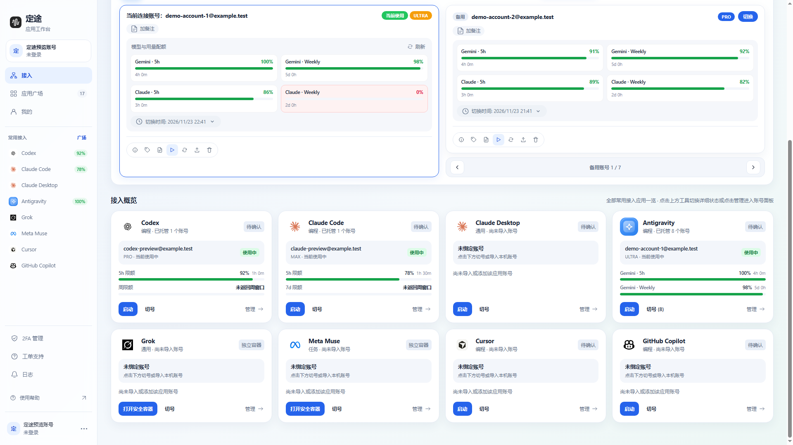
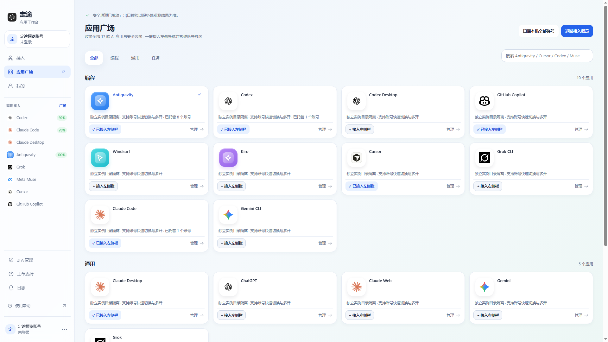
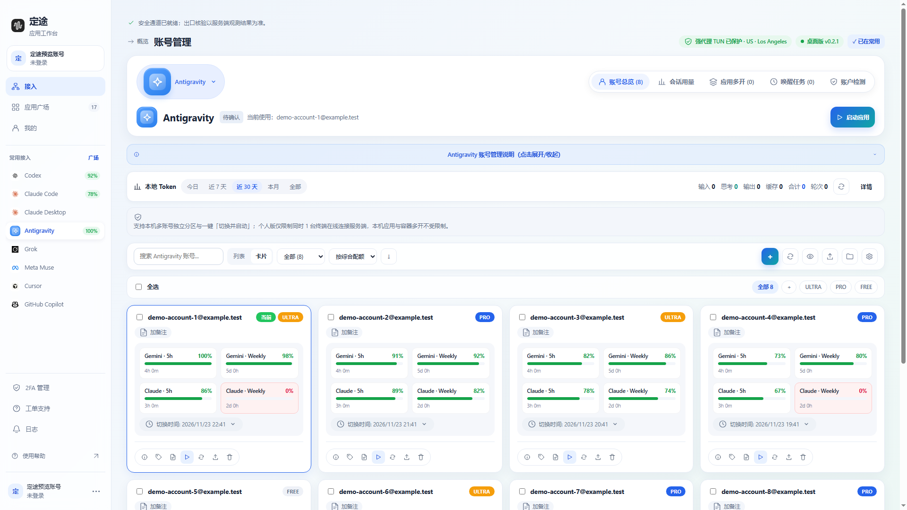
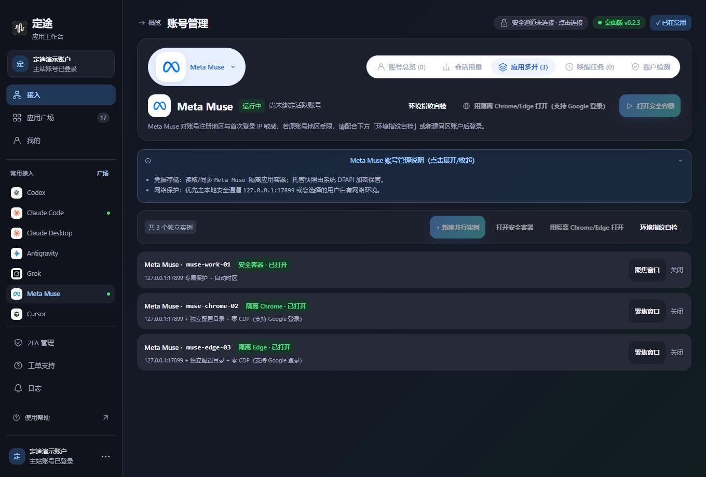
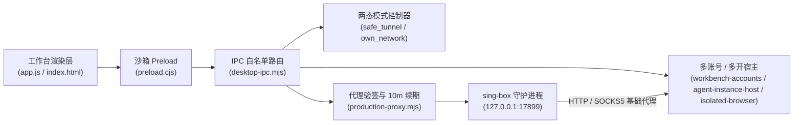
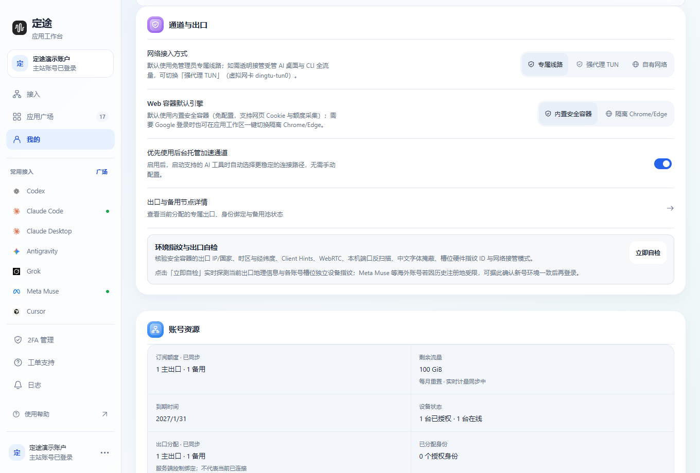

<div align="center">


# 定途桌面端 Dingtu Desktop `v0.2.0`（开源学习交流版）


<p>
  
  
  
  
</p>

[返回仓库首页](../README.md) · [官方完整版下载](https://dingtu.noyapi.cn/download)

</div>

---

> [!IMPORTANT]
> **开源学习交流版说明**：桌面端 `v0.2.0` 完整保留了定途 2.0 工作台的 **多账号无缝切换、应用多开、17 款 AI Agent 注册表、OS 原生安全存储、2FA TOTP 与 AI 用量/工单系统**，并保留 `127.0.0.1:17899` 基础代理联通；同时**已精确剥离「强代理 TUN（`strong_tun`）、Windows UAC 提权（`tun-privilege`）、双进程零停机中继（`loopback-relay`）以及环境指纹加强与防风控控件/模块（`anti-detect-fingerprint` / CDP 指纹注入 / 时区与字体掩码 / 环境指纹自检）」**。完整官方版请前往官网下载：**[https://dingtu.noyapi.cn/download](https://dingtu.noyapi.cn/download)**。

---

## 界面视觉与工作台能力

<table>
  <tr>
    <td align="center" width="50%">
      <br/>
      <sub><b>接入总览：多账号 5h / Weekly 配额与基础代理联通状态</b></sub>
    </td>
    <td align="center" width="50%">
      <br/>
      <sub><b>应用广场：17 款 AI 工作台统一接入 · 多账号切换 · 应用多开</b></sub>
    </td>
  </tr>
</table>

<p align="center">
  &nbsp;&nbsp;
  &nbsp;&nbsp;
  &nbsp;&nbsp;
  &nbsp;&nbsp;
  &nbsp;&nbsp;
  &nbsp;&nbsp;
  &nbsp;&nbsp;
  
</p>

---

## 桌面端核心能力详述

### 1. 多账号无缝切换与配额工作台

- **安全原子切换与防串号校准**：主进程 `workbench-accounts.mjs` 与 `local-account-importers.mjs` 在切号前自动备份现行配置目录，并校验账号元数据（如 Codex / Antigravity `authMeta`），异常时自动回滚自愈。
- **多种导入方式**：支持自动嗅探导入本机已登录 AI 应用/CLI 账号，支持 Token / Refresh Token 单条接入，支持批量 JSON 导入/导出（不含明文密码外泄）及企业加密接力池管理。
- **配额与辅助效率工具**：实时查询 **5h / Weekly** 配额条；支持分组、别名标签、定时唤醒（`wakeup-scheduler.mjs`）以及 RFC 6238 TOTP 二次验证令牌与迁移二维码导入。

<table>
  <tr>
    <td align="center" width="50%">
      <br/>
      <sub><b>接入总览：多账号 5h / Weekly 额度对比与一键切号</b></sub>
    </td>
    <td align="center" width="50%">
      <br/>
      <sub><b>多账号池：支持搜索、分组筛选、ULTRA/PRO 分级与多开协同</b></sub>
    </td>
  </tr>
</table>

### 2. 应用多开（CLI / IDE / 独立网页容器）

| 实例类型 | 隔离机制 | 多开体验 |
| --- | --- | --- |
| **命令行 AI Agent** (`claude-code`, `codex`, `gemini-cli`, `grok-cli`) | `safe-environment.mjs` + `agent-instance-host.mjs` 为不同别名注入独立 `CLAUDE_CONFIG_DIR` / `CODEX_HOME` / `GEMINI_CLI_HOME` / `GROK_HOME` 与 `127.0.0.1:17899` 代理环境变量 | 多个终端/实例同时以不同账号并发运行 |
| **桌面 IDE 与应用** (`antigravity`, `cursor`, `windsurf`, `kiro`, `codex-desktop`, `claude-desktop`) | 主实例保留本机原生配置；副实例自动挂载按作用域隔离的独立 `--user-data-dir` 与进程句柄管理（含一键关闭旧进程防止配置文件锁死） | 多窗口独立登录、快速切号重启 |
| **网页工作台容器** (`metamuse`, `manus`, `chatgpt`, `claude`, `gemini-web`, `grok`, `copilot`) | `isolated-browser.mjs` 按设备作用域+应用+实例生成 `persist:dingtu-browser-<sha256>` 独立分区，隔离 Cookie/Storage 并阻断本机/局域网端口扫描 | 同一官网支持多账号并发在线且永久保持登录态 |

<p align="center">
  <br/>
  <sub><b>深色应用多开视图：安全容器 / 隔离 Chrome / 隔离 Edge 多实例并行隔离管理</b></sub>
</p>

### 3. 全收录 17 款 AI Agent 与应用清单

- **编程类（10 款）**：`antigravity`（Antigravity）、`codex`（Codex）、`codex-desktop`（Codex Desktop）、`copilot`（GitHub Copilot）、`windsurf`（Windsurf）、`kiro`（Kiro）、`cursor`（Cursor）、`grok-cli`（Grok CLI）、`claude-code`（Claude Code）、`gemini-cli`（Gemini CLI）
- **任务应用类（3 款）**：`claude-desktop`（Claude Desktop）、`metamuse`（Meta Muse）、`manus`（Manus）
- **通用对话网页容器（4 款）**：`chatgpt`（ChatGPT）、`claude`（Claude Web）、`gemini-web`（Gemini）、`grok`（Grok）

<p align="center">
  <br/>
  <sub><b>应用广场实拍：17 款编程 / 任务 / 通用对话 AI 全收录</b></sub>
</p>

---

## 关于「提权与环境指纹 / 防风控控件与模块」的剥离与完整版对照



| 模块 / 控件 | 开源学习交流版处置 | 官网完整版专属加强能力（[dingtu.noyapi.cn/download](https://dingtu.noyapi.cn/download)） |
| --- | --- | --- |
| **提权与强代理 TUN 模块** (`tun-privilege.mjs` / `strong_tun` / `dingtu-tun0`) | **彻底删除**；移除 UAC 提权探测、`Verb RunAs` 重启弹窗、`proxy.elevation.status` / `proxy.tun.relaunchElevated` IPC | Windows UAC 受控提权建立 `dingtu-tun0` Wintun 虚拟网卡，实现内核级仅针对白名单 AI 进程的流控与 UDP/DNS 接管 |
| **零停机平滑热中继** (`loopback-relay.mjs`) | **彻底删除**；使用常规进程配置重载 | 前后端双 `sing-box` 分离架构，每 8m30s 租约轮换密钥时自动热切换到新后端，TUN 连接不断流 |
| **CDP 环境指纹引擎与防泄露锁** (`anti-detect-fingerprint.mjs`) | **彻底删除**；仅注入 Clean Chrome UA 与 `17899` 基础代理，不修改时区/语言/字体/WebRTC | 0ms CDP 注入实例种子绑定的 Canvas/WebGL/Audio/Screen/Client Hints 硬件指纹、CJK 字体屏蔽、自动对齐出口时区/语言/经纬度、WebRTC 禁用非代理 UDP 与 `--host-resolver-rules` 防 DNS 泄露 |
| **「环境指纹自检」UI 与 IPC** (`browser.fingerprintCheck`) | **已移除**；设置页与总览页展示「开源学习交流版（基础联通）」提示横幅 | 一键核验真实出口 IP、观测时区、语言、UA、Client Hints、字体掩码、`dingtu-tun0` 状态并出具诊断报告 |
| **第三方 Google OAuth 内置凭据** (`oauth-account-flow.mjs`) | **改为环境变量读取**：`DINGTU_ANTIGRAVITY_OAUTH_CLIENT_*` / `DINGTU_GEMINI_CLI_OAUTH_CLIENT_*` | 官网正式版内置完整可用凭据配置 |

<p align="center">
  <br/>
  <sub><b>完整版环境加强UI示意图：GitHub 开源版（及 Releases 开源便携版）已移除图中「强代理 TUN」「Web 容器默认引擎」「环境指纹与出口自检」控件，完整体验请赴 <a href="https://dingtu.noyapi.cn/download">官网下载</a></b></sub>
</p>

> 如需直接体验本开源版，可在 [GitHub Releases (`desktop-v0.2.0`)](https://github.com/guowei-3399/dingtu-client/releases/tag/desktop-v0.2.0) 获取由开源剥离源码编译的 Windows 便携版 `.exe`（附 `.sha256`）。

---

## 本地同步与单元测试

```bash
cd desktop

# 同步渲染层到 electron/ 并校验 Ed25519 公钥信任锚
node electron/sync-renderer.cjs
node electron/production-trust.mjs

# 运行全部 323 项单元测试（根套件 59 + Electron 主进程 251 + 原生存储 13）
node --test --test-concurrency=2 *.test.mjs
node --test --test-concurrency=2 electron/*.test.mjs
node --test --test-concurrency=1 native/*.test.mjs
```
