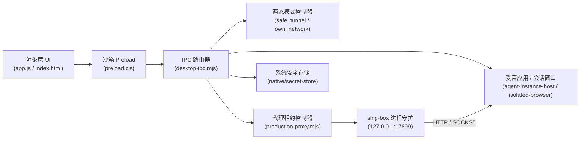

<div align="center">


# 定途桌面端 Dingtu Desktop `v0.2.0`（开源学习交流版）


<p>
  
  
  
</p>

[返回仓库首页](../README.md) · [官方完整版下载](https://dingtu.noyapi.cn/download)

</div>

---

> [!IMPORTANT]
> **开源学习交流版说明**：桌面端 `v0.2.0` 已剥离 `strong_tun` 虚拟网卡、UAC 提权、`loopback-relay` 热切换中继、CDP/WebRTC/时区/语言/字体指纹与防风控检测模块，仅保留 **两态环境模式（`safe_tunnel` 基础代理 `127.0.0.1:17899` 与 `own_network` 自有网络）** 及定途 2.0 UI 工作台。完整官方发行版请前往官网下载：**[https://dingtu.noyapi.cn/download](https://dingtu.noyapi.cn/download)**。

---

## 界面视觉与支持应用

<table>
  <tr>
    <td align="center" width="50%">
      <br/>
      <sub><b>基础代理通道状态（127.0.0.1:17899）</b></sub>
    </td>
    <td align="center" width="50%">
      <br/>
      <sub><b>多 AI 应用工作台与本机凭据协同</b></sub>
    </td>
  </tr>
</table>

<p align="center">
  &nbsp;&nbsp;
  &nbsp;&nbsp;
  &nbsp;&nbsp;
  &nbsp;&nbsp;
  &nbsp;&nbsp;
  &nbsp;&nbsp;
  &nbsp;&nbsp;
  
</p>

---

## 核心架构与简化模块边界



### 剥离与保留清单

| 组件 | 开源版状态 | 说明 |
| --- | --- | --- |
| `electron/main.mjs` / `preload.cjs` / `desktop-ipc.mjs` | **保留（精简 IPC 白名单）** | 移除 `proxy.elevation.status`、`proxy.tun.relaunchElevated`、`browser.fingerprintCheck` |
| `electron/environment-mode.mjs` | **两态精简** | 仅允许 `safe_tunnel` 与 `own_network`，禁止切换 `strong_tun` |
| `electron/production-proxy.mjs` / `local-proxy.mjs` | **基础代理保留** | Ed25519 验签 + 闭合校验 + 10 分钟续租；硬锁定 `127.0.0.1:17899`，拒绝启动 `tun`/`redirect`/`tproxy` |
| `electron/isolated-browser.mjs` / `oauth-browser-window.mjs` / `external-oauth-browser.mjs` | **基础会话容器保留** | 独立 `persist:` 会话隔离、本地端口扫描防护与 `17899` 代理；已移除 CDP/时区/语言/WebRTC/Client Hints 篡改 |
| `electron/safe-environment.mjs` | **基础环境注入保留** | 仅注入基础 `HTTP_PROXY` / `ALL_PROXY` / 独立 `user-data-dir` 与安全 `NO_PROXY` |
| `tun-privilege.mjs` / `loopback-relay.mjs` / `anti-detect-fingerprint.mjs` | **已删除** | 对应高阶隔离与防风控增强请下载[官方完整版](https://dingtu.noyapi.cn/download) |

---

## 本地同步与测试验证

```bash
cd desktop

# 同步前端文件到 electron/ 运行目录并校验证书信任锚
node electron/sync-renderer.cjs
node electron/production-trust.mjs

# 运行全部测试（根套件 59 + Electron 主进程套件 251 + 原生存储套件 13 = 323 项）
node --test --test-concurrency=2 *.test.mjs
node --test --test-concurrency=2 electron/*.test.mjs
node --test --test-concurrency=1 native/*.test.mjs
```
